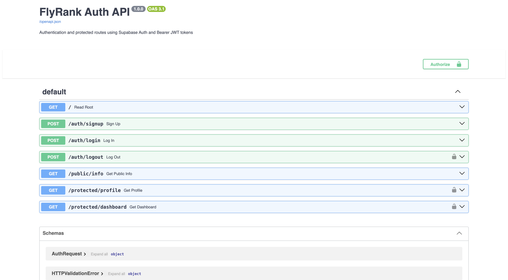

# FlyRank Backend Internship - Week 4: Auth · Login & protect

A secure RESTful API built with **Python 3.10+** and **FastAPI**, using **Supabase Auth** as the trusted Identity Provider. It handles user registration, authentication, token issuance (JWT), and route protection via Bearer authentication dependencies.

---

## Architecture Overview: The Trust Triangle

Authentication operates as a secure trust triangle between three components:
1. **Client:** Submits credentials (email & password) to the API.
2. **Identity Provider (Supabase Auth):** Validates credentials, hashes passwords, manages user sessions, and cryptographically signs JSON Web Tokens (JWT).
3. **Backend API (FastAPI):** Guards protected endpoints by extracting the Bearer token from the `Authorization` header, verifying its signature via Supabase, and injecting the authenticated user into the route handlers.

---

## Features
- **No DIY Cryptography:** Security relies on Supabase Auth (passwords are never stored or hashed manually in the app).
- **Bearer Token Auth:** Standard `Authorization: Bearer <token>` header inspection.
- **Reusable Guard Middleware:** FastAPI `Depends(get_current_user)` dependency protecting any route without code duplication.
- **Zero Credentials in Git:** API keys are managed through `.env` (git-ignored) with a committed `.env.example` template.
- **Interactive Swagger UI:** Interactive OpenAPI documentation with Bearer auth padlock (`/docs`).

---

## API Endpoints Reference

| Method | Endpoint | Description | Auth Required | Success | Errors |
| :--- | :--- | :--- | :--- | :--- | :--- |
| **GET** | `/` | API status metadata | None | 200 | - |
| **GET** | `/public/info` | Public lobby data | None | 200 | - |
| **POST** | `/auth/signup` | Create user account | None | 201 | 400 |
| **POST** | `/auth/login` | Login & receive JWT | None | 200 | 400, 401 |
| **POST** | `/auth/logout` | End current session | Bearer JWT | 204 | 401 |
| **GET** | `/protected/profile` | Read private profile | Bearer JWT | 200 | 401 |
| **GET** | `/protected/dashboard`| Dashboard data | Bearer JWT | 200 | 401 |

---

## How to Install and Run

### 1. Requirements
- Python 3.10+
- A free Supabase project with Email Provider enabled

### 2. Setup Environment
Clone the repository and copy the example environment file:
```bash
cp .env.example .env
```
Fill in your Supabase Project URL and anon key inside `.env`:
```ini
SUPABASE_URL=https://your-project.supabase.co
SUPABASE_KEY=your_anon_key_here
PORT=8000
```

### 3. Install Dependencies
```bash
pip install -r requirements.txt
```

### 4. Start the Server
```bash
uvicorn main:app --reload
```
The server will be available at `http://localhost:8000`.

---

## Interactive Swagger Documentation
Open `http://localhost:8000/docs` in your browser.
1. Call `POST /auth/login` to obtain an `access_token`.
2. Click the green **Authorize** (Padlock) button at the top right of the Swagger UI.
3. Paste the `access_token` into the input field and click **Authorize**.
4. Test any protected route (`/protected/profile`, `/protected/dashboard`) directly from the browser.

### Swagger UI Screenshot


---

## Sample `curl` Session

### 1. Register a new user
```bash
$ curl -i -X POST http://localhost:8000/auth/signup \
  -H "Content-Type: application/json" \
  -d '{"email":"dev@example.com","password":"SecretPassword123!"}'

HTTP/1.1 201 Created
{"message":"User registered successfully","user":{"id":"...","email":"dev@example.com"}}
```

### 2. Log in and get JWT token
```bash
$ curl -i -X POST http://localhost:8000/auth/login \
  -H "Content-Type: application/json" \
  -d '{"email":"dev@example.com","password":"SecretPassword123!"}'

HTTP/1.1 200 OK
{"access_token":"eyJhbGciOi...","token_type":"bearer",...}
```

### 3. Access protected route without token (Rejected: 401)
```bash
$ curl -i http://localhost:8000/protected/profile

HTTP/1.1 401 Unauthorized
{"detail":{"error":"Access token required"}}
```

### 4. Access protected route with Bearer token (Success: 200)
```bash
$ curl -i http://localhost:8000/protected/profile \
  -H "Authorization: Bearer <PASTE_YOUR_ACCESS_TOKEN>"

HTTP/1.1 200 OK
{"id":"...","email":"dev@example.com","created_at":"..."}
```

---

## Automated Test Suite
Run the end-to-end automated test suite:
```bash
python test_auth.py
```
Outputs:
```
1. Signed up user successfully
2. Logged in and received access_token successfully
3. Accessed protected profile
4. Accessed protected dashboard using the same middleware guard
5. Logged out successfully (204 No Content)

All auth tests passed successfully!
```
